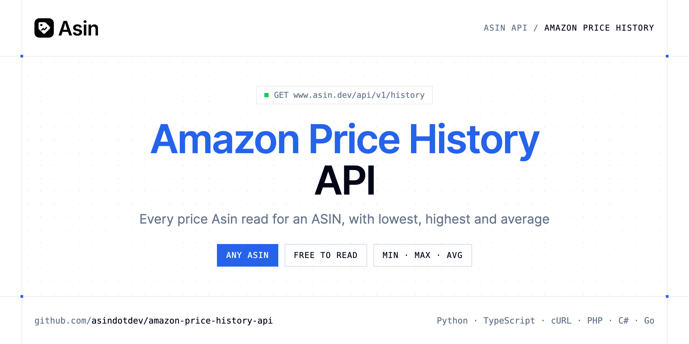

<p align="center">
  <a href="https://www.asin.dev"></a>
</p>

# Amazon Price History API

[](https://www.asin.dev/signup) [](https://www.asin.dev/docs) [](LICENSE)

The **Asin Amazon Price History API** returns every price Asin read for an ASIN on a marketplace over a period, oldest first, with the lowest, highest and average of those prices.

- **Price History of Any ASIN** — Every price Asin read for an ASIN on a marketplace over the period, whoever tracks it, oldest first, with the lowest, highest and average of those prices.
- **Price History of a Tracked Product** — The product's latest state and every price read of the period, oldest first.

Use it for price charts, "is this a good price?" features, deal scoring and market research.

| Endpoint | Request | Cost |
|---|---|---|
| [Price History of Any ASIN](#price-history-of-any-asin) | `GET /history` | Free |
| [Price History of a Tracked Product](#price-history-of-a-tracked-product) | `GET /products/{id}` | No credit |

## Table of contents

- [How it works](#how-it-works)
- [Price History of Any ASIN](#price-history-of-any-asin)
- [Price History of a Tracked Product](#price-history-of-a-tracked-product)
- [Code examples in other languages](#code-examples-in-other-languages)
- [Use cases](#use-cases)
- [Why Asin?](#why-asin)
- [FAQ](#faq)
- [Related repositories](#related-repositories)
- [Support](#support)

## How it works

1. **[Create an Asin account](https://www.asin.dev/signup)** and copy your API key from [your account](https://www.asin.dev/app#api).
2. **Call `https://www.asin.dev/api/v1`** with the header `Authorization: Bearer YOUR_API_KEY`.
3. **Use the result** in your app, or let Asin email you when a price moves.

```bash
export ASIN_API_KEY="your-api-key"
pip install requests        # Python
# TypeScript: Node.js 18+ (native fetch), run with `npx tsx file.ts`
```

## Price History of Any ASIN

Every price Asin read for an ASIN on a marketplace over the period, whoever tracks it, oldest first, with the lowest, highest and average of those prices. A history of more than 5000 points is thinned evenly, keeping its first and last point. Free, limited to 600 reads per hour: no credit is used and nothing is read from Amazon, so an ASIN nobody tracked yet has an empty history.

`GET https://www.asin.dev/api/v1/history` · **Free** · [API reference](https://www.asin.dev/docs)

### Request parameters

| Parameter | In | Type | Required | Description |
|---|---|---|---|---|
| `asin` | query | string | ✅ | 10-character ASIN |
| `marketplace` | query | string (`com`, `co.uk`, `de`, `fr`, `it`, `es`) | — | Amazon store, e.g. com for amazon.com |
| `days` | query | integer | — | History period in days |

### Python example

```python
import os

import requests

API_KEY = os.environ["ASIN_API_KEY"]
HEADERS = {"Authorization": f"Bearer {API_KEY}"}

response = requests.get(
    "https://www.asin.dev/api/v1/history",
    headers=HEADERS,
    params={
        "asin": "B09DFCB66S",
        "marketplace": "com",
        "days": "90",
    },
    timeout=120,
)
response.raise_for_status()

data = response.json()
print(data)
```

### TypeScript example

```typescript
type PriceHistoryOfAnyAsin = {
  asin?: string;
  marketplace?: string;
  currency?: string;
  lowest_price?: number;
  highest_price?: number;
  average_price?: number;
  history?: {
    price?: number;
    in_stock?: boolean;
    coupon?: string;
    seller?: string;
    checked_at?: string;
  }[];
};

const headers = { Authorization: `Bearer ${process.env.ASIN_API_KEY!}`, "Content-Type": "application/json" };

const params = new URLSearchParams({
  "asin": "B09DFCB66S",
  "marketplace": "com",
  "days": "90",
});

const response = await fetch(`https://www.asin.dev/api/v1/history?${params}`, { headers });
if (!response.ok) throw new Error(`HTTP ${response.status}: ${await response.text()}`);

const data = (await response.json()) as PriceHistoryOfAnyAsin;
console.log(data);
```

### Output example

Example response from the API reference, abridged.

```json
{
  "asin": "B09DFCB66S",
  "marketplace": "com",
  "currency": "USD",
  "lowest_price": 74.5,
  "highest_price": 99.99,
  "average_price": 84.83,
  "history": [
    {
      "price": 99.99,
      "in_stock": true,
      "coupon": null,
      "seller": "example",
      "checked_at": "2026-10-01T09:30:35.002Z"
    },
    {
      "price": 74.5,
      "in_stock": true,
      "coupon": "Save 5%",
      "seller": "example",
      "checked_at": "2026-10-24T08:00:10.913Z"
    }
  ]
}
```

### Response fields

| Field | Type | Description |
|---|---|---|
| `asin` | string | 10-character ASIN |
| `marketplace` | string | Amazon store |
| `currency` | string | ISO 4217 code of the marketplace |
| `lowest_price` | number | Lowest price of the period |
| `highest_price` | number | Highest price of the period |
| `average_price` | number | Average of the period's prices |
| `history[]` | object[] |  |
| `history[].price` | number | null when there was no offer |
| `history[].in_stock` | boolean | Whether it was in stock |
| `history[].coupon` | string | Coupon shown, if any |
| `history[].seller` | string | Seller of the offer shown (Buy Box) |
| `history[].checked_at` | string | When Amazon was read |

## Price History of a Tracked Product

The product's latest state and every price read of the period, oldest first. The history covers every read of this ASIN on this marketplace, including those made before you added it, so a product added today can come with months of prices; created_at says when you added it. A history of more than 5000 points is thinned evenly, keeping its first and last point.

`GET https://www.asin.dev/api/v1/products/{id}` · **No credit** · [API reference](https://www.asin.dev/docs)

### Request parameters

| Parameter | In | Type | Required | Description |
|---|---|---|---|---|
| `id` | path | string | ✅ | product_id returned when the product was added |
| `days` | query | integer | — | History period in days |

### Python example

```python
import os

import requests

API_KEY = os.environ["ASIN_API_KEY"]
HEADERS = {"Authorization": f"Bearer {API_KEY}"}

response = requests.get(
    "https://www.asin.dev/api/v1/products/8f0b3c7e-2a4d-4e51-9c1a-6d2f1b9e7a30",
    headers=HEADERS,
    params={
        "days": "90",
    },
    timeout=120,
)
response.raise_for_status()

data = response.json()
print(data)
```

### TypeScript example

```typescript
type PriceHistoryOfATrackedProduct = {
  product_id?: string;
  asin?: string;
  marketplace?: string;
  url?: string;
  title?: string;
  image?: string;
  brand?: string;
  currency?: string;
  price?: number;
  first_price?: number;
  lowest_price?: number;
  highest_price?: number;
  in_stock?: boolean;
  stock?: string;
  coupon?: string;
  seller?: string;
  best_sellers_rank?: string;
  target_price?: number;
  alert_on_drop?: boolean;
  interval_minutes?: number;
  status?: string;
  last_error?: string;
  found_on?: string[];
  checking?: boolean;
  last_checked_at?: string;
  [key: string]: unknown;
};

const headers = { Authorization: `Bearer ${process.env.ASIN_API_KEY!}`, "Content-Type": "application/json" };

const params = new URLSearchParams({
  "days": "90",
});

const response = await fetch(`https://www.asin.dev/api/v1/products/8f0b3c7e-2a4d-4e51-9c1a-6d2f1b9e7a30?${params}`, { headers });
if (!response.ok) throw new Error(`HTTP ${response.status}: ${await response.text()}`);

const data = (await response.json()) as PriceHistoryOfATrackedProduct;
console.log(data);
```

### Output example

Example response from the API reference, abridged.

```json
{
  "product_id": "8f0b3c7e-2a4d-4e51-9c1a-6d2f1b9e7a30",
  "asin": "B09DFCB66S",
  "marketplace": "com",
  "url": "https://www.amazon.com/dp/B09DFCB66S",
  "title": "Wireless Earbuds, Bluetooth 5.3, Noise Cancelling",
  "image": "https://m.media-amazon.com/images/I/…jpg",
  "brand": "Example Audio",
  "currency": "USD",
  "price": 79.99,
  "first_price": 99.99,
  "lowest_price": 74.5,
  "highest_price": 99.99,
  "in_stock": true,
  "stock": "In Stock",
  "coupon": null,
  "seller": "example",
  "best_sellers_rank": "#152 in Electronics",
  "target_price": 70,
  "alert_on_drop": true,
  "interval_minutes": 1440,
  "status": "active",
  "last_error": null,
  "found_on": [],
  "checking": false,
  "last_checked_at": "2026-11-03T08:00:12.441Z"
}
```

### Response fields

| Field | Type | Description |
|---|---|---|
| `product_id` | string | Id of this watchlist entry |
| `asin` | string | Amazon's 10-character product code |
| `marketplace` | string | Amazon store |
| `url` | string | Product page on Amazon |
| `title` | string | null until the first check |
| `image` | string | Main product image |
| `brand` | string | Brand shown by Amazon |
| `currency` | string | ISO code, e.g. USD, EUR, JPY |
| `price` | number | Latest price; null when there is no offer |
| `first_price` | number | Price at the first check |
| `lowest_price` | number | Lowest price seen |
| `highest_price` | number | Highest price seen |
| `in_stock` | boolean | null until the first check |
| `stock` | string | Amazon's availability text |
| `coupon` | string | Coupon shown on the page, if any |
| `seller` | string | Seller of the offer shown (Buy Box) |
| `best_sellers_rank` | string | Main Best Sellers Rank |
| `target_price` | number | Alert threshold |
| `alert_on_drop` | boolean | Email when the price drops or the product is back in stock |
| `interval_minutes` | integer | Minutes between two checks |
| `status` | string | Paused products aren't checked |
| `last_error` | string | Why the last check didn't go through, if it didn't |
| `found_on` | string[] | When last_error is product_not_found: marketplaces where the ASIN exists |
| `checking` | boolean | A check is due or running; poll until it's false |
| `last_checked_at` | string | When the last check ran |

## Code examples in other languages

Ready-to-run examples live in [`examples/`](examples); each reads your key from `ASIN_API_KEY`.

| Language | `asin-history` | `tracked-history` |
|---|---|---|
| cURL (Bash) | [asin_history.sh](examples/curl/asin_history.sh) | [tracked_history.sh](examples/curl/tracked_history.sh) |
| PHP | [asin_history.php](examples/php/asin_history.php) | [tracked_history.php](examples/php/tracked_history.php) |
| C# | [AsinHistory.cs](examples/csharp/AsinHistory.cs) | [TrackedHistory.cs](examples/csharp/TrackedHistory.cs) |
| Go | [asin_history.go](examples/go/asin_history.go) | [tracked_history.go](examples/go/tracked_history.go) |
| Java | [AsinHistoryExample.java](examples/java/AsinHistoryExample.java) | [TrackedHistoryExample.java](examples/java/TrackedHistoryExample.java) |
| Ruby | [asin_history.rb](examples/ruby/asin_history.rb) | [tracked_history.rb](examples/ruby/tracked_history.rb) |
| Node.js | [asin_history.mjs](examples/nodejs/asin_history.mjs) | [tracked_history.mjs](examples/nodejs/tracked_history.mjs) |

## Use cases

- **Price charts** — Plot a product's price over time in your app.
- **Deal scoring** — Compare today's price with the lowest and average of the period.
- **Market research** — Study how prices move across products and marketplaces.

## Why Asin?

- **A watchlist that runs on its own** — each product is checked on schedule, from every 5 minutes to every 24 hours depending on the plan.
- **Price history for any ASIN** — read every price Asin has seen, free and without tracking the product.
- **Alerts by email** — price drops, target prices and products back in stock.
- **Pay for what you check** — each price check costs 1 credit (about 30 credits a month for a product checked daily) and failed checks are refunded. Free for 50 products.
- **Use it your way** — the same API key works with the REST API, the MCP server and the Chrome extension, with official SDKs in 7 languages.
- **Copy-paste examples** — Python and TypeScript in each README, 7 more languages in `examples/`.

## FAQ

### How do I authenticate?

[Create an Asin account](https://www.asin.dev/signup), copy your API key from [your account](https://www.asin.dev/app#api) and send it as `Authorization: Bearer YOUR_API_KEY` with every request to `https://www.asin.dev/api/v1`. Keys start with `asin_`.

### How much does it cost?

`GET /history`: Free, `GET /products/{id}`: No credit. Asin is free for 50 products; a product checked daily uses about 30 credits a month and failed checks are refunded. See [Asin pricing](https://www.asin.dev/pricing).

### Why is the history of my ASIN empty?

`GET /history` reads nothing from Amazon, so an ASIN nobody tracked yet has an empty history. Track it to start collecting prices.

### Is there a limit?

`GET /history` is free and limited to 600 reads per hour. A history of more than 5000 points is thinned evenly, keeping its first and last point.

### Which Amazon stores are supported?

11 marketplaces, set with `marketplace`: `com` (default), `co.uk`, `de`, `fr`, `it`, `es`, `ca`, `co.jp`, `com.br`, `com.mx` and `in`.

### Is there an official SDK?

Yes: [Python](https://github.com/asindotdev/asin-python), [Node.js & TypeScript](https://github.com/asindotdev/asin-node), [Go](https://github.com/asindotdev/asin-go), [PHP](https://github.com/asindotdev/asin-php), [Ruby](https://github.com/asindotdev/asin-ruby), [Java](https://github.com/asindotdev/asin-java) and [.NET](https://github.com/asindotdev/asin-dotnet), plus a [CLI](https://github.com/asindotdev/asin-cli) and an [MCP server](https://github.com/asindotdev/asin-mcp). The examples here use plain HTTP so you can see the raw API.

### Which languages are supported?

Any language that can make an HTTP request. This README shows Python and TypeScript; the [`examples/`](examples) folder contains cURL, PHP, C#, Go, Java, Ruby and Node.js.

## Related repositories

- [Amazon Price Tracker API](https://github.com/asindotdev/amazon-price-tracker-api)
- [Amazon Price Alerts API](https://github.com/asindotdev/amazon-price-alerts-api)
- [Amazon Offers API](https://github.com/asindotdev/amazon-offers-api)
- [Amazon Search API](https://github.com/asindotdev/amazon-search-api)
- [All Asin repositories](https://github.com/asindotdev)

## Support

- 📚 Read the [API reference](https://www.asin.dev/docs).
- ✉️ Write to [contact@asin.dev](mailto:contact@asin.dev).
- 🔑 [Get your API key](https://www.asin.dev/signup).

---

<p align="center">
  <a href="https://www.asin.dev">
    <picture>
      <source media="(prefers-color-scheme: dark)" srcset="images/logo-dark.svg">
      
    </picture>
  </a>
  <br>
  <sub>Built by <a href="https://www.asin.dev">Asin</a>. Examples are released under the MIT license.</sub>
</p>
